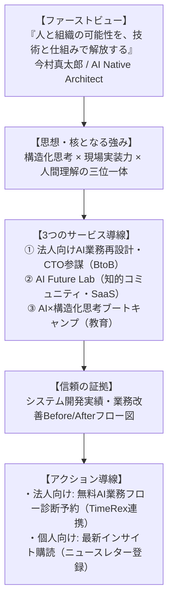

# 今村真太郎氏 ホームページ立ち上げ企画案

**作成日:** 2026年10月31日  
**対象者:** 今村真太郎（システム設計者／PM／AIネイティブ構想家）  
**目的:** 中核強み（構造化・要件定義 × AI実装 × 人間・組織変革）を武器に、社会的信頼の獲得と高単価マネタイズを最速で実現するためのホームページ立ち上げプラン。

---

## 1. 立ち上げの全体像：3つの選択肢

```
┌────────────────────────────────────────────────────────────────────────┐
│ 1. 案A【最速キャッシュ獲得型】BtoB AI業務再設計・参謀公式サイト        │
│    👉「今すぐ高単価な顧問・PM案件（月50万〜150万円）を受注したい」方向け│
├────────────────────────────────────────────────────────────────────────┤
│ 2. 案B【知的ブランド・母艦型】「AI Future Lab」主宰 オフィシャルサイト │
│    👉「先進的な知的リーダーとして権威性を確立し、長期資産にしたい」方向け│
├────────────────────────────────────────────────────────────────────────┤
│ 3. 案C【ハイブリッド型（★一番おすすめ）】思想×高単価BtoBの総合ポータル  │
│    👉「格調高いブランド観で信頼を得つつ、裏で確実に商談を獲得する」形   │
└────────────────────────────────────────────────────────────────────────┘
```

---

## 2. 詳細プラン比較

### 案A：【最速キャッシュ獲得型】BtoB AI業務再設計・参謀公式サイト
> **キャッチコピー:**  
> **「AIツール導入で終わらせない。業務フローを構造化し、実行可能な仕組みへ変える」**

- **サイトの目的:** 中小・中堅企業経営者からの「AI業務再設計 顧問」「Fractional CTO（月額50万〜150万円）」の商談獲得。
- **メインターゲット:** 売上3億〜50億円の中小・中堅企業経営者、役員、DX推進責任者。
- **ターゲットのペイン:**
  - ChatGPTやCopilotを導入したが現場が使いこなせず形骸化している
  - 手作業・定型業務が多く、属人化と長時間労働から抜け出せない
  - 社内にIT・AIの専門家がおらず、外注ベンダーの選定や管理が不安
- **ページ構成（縦長1ページ完結型 LP）:**
  1. **ファーストビュー:**  
     「ツール導入失敗率80%の壁を越える。業務構造化から始めるAIネイティブ組織変革」  
     *CTA:*「限定3社：貴社業務のAI適応度・無料構造化診断（60分）を申し込む」
  2. **現場の3大失敗パターン（共感）:**  
     「プロンプト研修だけで終わる」「現場が反発する」「既存システムと繋がらない」
  3. **独自の3ステップ変革メソッド:**  
     - **Step 1: 業務の徹底構造化**（泥臭いヒアリングと業務フローの可視化）
     - **Step 2: AIエージェント実装**（現場が毎日使う実務直結ワークフローの構築）
     - **Step 3: 組織への定着伴走**（社内リーダー育成と自走化支援）
  4. **導入シミュレーション / 事例（Before / After）:**  
     - バックオフィス工数65%削減、月間200時間の余力創出事例
  5. **プラン・料金体系:**  
     - ライト顧問プラン（Fractional CTO）：月額30万〜50万円
     - フルコミット組織再設計プラン：月額80万〜150万円
  6. **プロフィール:** システム開発会社運営 × 業務設計 × AI実装の確かなバックボーン
  7. **最終CTA:** 日程調整ツール（TimeRex / Calendly）直結の商談予約
- **立ち上げ所要期間:** **最短1週間**（STUDIOで即日着手可能）

---

### 案B：【知的ブランド・母艦型】「AI Future Lab」主宰 オフィシャルサイト
> **キャッチコピー:**  
> **「人と組織の可能性を、技術と仕組みで解放する」**

- **サイトの目的:** 思想家・システムアーキテクトとしての唯一無二のポジション確立。商業出版、講演、コミュニティ、SaaSへのハブ。
- **メインターゲット:** 先進的イノベーター、知的人材、提携先、メディア、大企業新規事業部門。
- **デザイン方針:** 洗練されたミニマリズム。白・ディープブルー・チャコールグレー基調。タイポグラフィ重視。
- **ページ構成（複数ページ型ブランドサイト）:**
  1. **Home:**  
     マニフェスト（思想）、3つの活動領域、最新インサイト、プロフィール要約
  2. **Philosophy（思想）:**  
     AIを単なる効率化ツールではなく「人間の知的活動を拡張する基盤」と捉える哲学。人はどう変わるのか、組織はどう進化するのかの論考
  3. **AI Future Lab:**  
     知的探究機関としての構想、意思決定支援SaaS、リサーチ活動の紹介
  4. **Services:**  
     法人向け業務設計伴走、次世代リーダー向けブートキャンプ
  5. **Journal / Insights:**  
     哲学・技術・人間理解・ロボティクスを横断する深層コラム
  6. **About / Contact:**  
     経歴、価値観、メディア取材・講演・事業相談フォーム
- **立ち上げ所要期間:** **2〜3週間**

---

### 案C：【ハイブリッド型（★一番推奨）】思想×高単価BtoBの総合ポータル
> **「思想で格調高い信頼を勝ち取り、中盤から実利的な高単価商談に落とし込む」**

トップページで「思想・哲学」を堂々と語ることで、安っぽい「AI受託屋」との決定的な差別化を図り、その直後に具体的な「法人向け解決策（高単価伴走）」と「無料診断」を配置する、最も収益性とブランディングのバランスが取れた構造です。



---

## 3. ドメイン選定 ＆ 制作プラットフォーム

### ① ドメイン候補案
- **個人ブランド軸:**
  - `shintaroimamura.com`（最も王道・信頼性が高い）
  - `shintaro.ai`（AIネイティブ感を強く打ち出す場合）
- **Lab・ブランド軸:**
  - `aifuturelab.jp`（日本国内向けに信頼感を出す場合）
  - `aifuturelab.io`（先進的なテック・SaaS感を出す場合）

### ② 制作プラットフォームの比較

| ツール | 特徴 | コスト | 最短公開 | 推奨用途 |
| :--- | :--- | :--- | :--- | :--- |
| **STUDIO（推奨）** | 日本発ノーコード。デザイン自由度が極めて高く、洗練されたサイトが作れる。フォーム・独自ドメイン・レスポンシブ標準対応。 | 月額980円〜 | **1〜3日** | **案A（LP）または案C（ハイブリッド）の初期立ち上げに最適** |
| **Next.js / Astro** | 高速表示・拡張性最強。会員認証、AI診断Webアプリ、サブスク決済を自社サイト内に直接実装可能。 | サーバー代ほぼ無料（Vercel） | 1〜2週間 | **将来的に「AI Future Lab」やSaaSを統合する段階** |
| **WordPress** | 記事（ブログ・SEO）を大量に投稿するメディア型には向くが、デザイン調整に工数がかかる。 | 月額1,000円程度 | 1週間 | 記事更新を最優先にする場合のみ |

> **💡 Antigravityからの推奨:**  
> まずは **「STUDIO」** を使い、案Aまたは案Cの形で**最短1週間で公開**することをお勧めします。デザインの修正やABテストが即座にでき、エンジニアリングのリソースを消費せずに最速で商談獲得のテストが可能です。

---

## 4. 立ち上げロードマップ（最短14日間）

```
┌────────────────────────────────────────────────────────────────────────┐
│ 📅 ホームページ立ち上げ 14日間スケジュール                              │
├────────────────────────────────────────────────────────────────────────┤
│                                                                        │
│ 【Day 1〜3: コンセプト確定＆原稿作成】                                 │
│  ・ファーストビューのキャッチコピー確定                                │
│  ・プロフィール、強み（構造化×実装×人間理解）の整理                   │
│  ・「無料AI業務フロー診断（60分）」のオファー設計                      │
│                                                                        │
│ 【Day 4〜7: デザイン＆STUDIO構築】                                     │
│  ・ドメイン取得（shintaroimamura.com等）                               │
│  ・STUDIOにてPC/スマホ両対応のデザインレイアウト構築                  │
│  ・Before/Afterフロー図などの視覚アセット配置                          │
│                                                                        │
│ 【Day 8〜10: 外部ツール連携＆導線テスト】                              │
│  ・日程調整ツール（TimeRex）とGoogleカレンダーの連携                   │
│  ・問い合わせフォーム・通知テスト                                      │
│  ・アクセス解析（Google Analytics / Search Console）設定               │
│                                                                        │
│ 【Day 11〜14: 公開＆初動アプローチ】                                   │
│  ・独自ドメイン接続＆正式公開                                          │
│  ・SNS（X/LinkedIn/Facebook）プロフィールにURL設置                     │
│  ・既存の取引先や知人経営者5〜10名に「HP公開＆無料診断」の案内連絡    │
│                                                                        │
└────────────────────────────────────────────────────────────────────────┘
```
