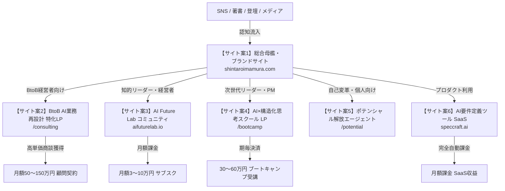

# 今村真太郎氏の事業実行に向けたウェブサイト構築企画案

**作成日:** 2026年10月31日  
**対象者:** 今村真太郎（システム設計者／PM／AIネイティブ構想家）  
**目的:** 収益化アイデア（高単価伴走・ストックSaaS・教育スクール・知的コミュニティ）を最速で形にし、認知・集客・高単価受注・決済を自動化するためのウェブサイト案の策定。

---

## 1. 全体アーキテクチャ：ウェブサイト群の連携エコシステム

単一のサイトにすべてを詰め込むのではなく、**「総合母艦サイト」**を中心に据え、目的に応じた**「特化型ランディングページ（LP）／プロダクトサイト」**を連携させることで、ブランドの格調と成約率（CVR）を両立させます。



---

## 2. 厳選ウェブサイト企画案（全6パターン）

---

### 🌐 サイト案 1：総合母艦・パーソナルフラッグシップサイト
> **「人と組織の可能性を、技術と仕組みで解放する」**

- **サイト役割:** 今村真太郎氏の思想・哲学・実績・全事業へのハブ。メディア取材、出版、大型提携、登壇依頼の窓口。
- **ターゲット:** 提携先企業、大企業経営企画、投資家、メディア関係者、全サービスの検討者。
- **デザインイメージ:**  
  洗練されたミニマリズム、知的なブルー・チャコールグレー基調。タイポグラフィを重視し、思想家と実践的エンジニアが融合した風格。
- **主要コンテンツ構成:**
  1. **Hero View:** 思想とタグライン、「動く仕組み」を想起させる美しいインタラクション
  2. **Philosophy（思想）:** なぜAIなのか、人はどう変わるのか、組織の解放とは何か
  3. **3つの事業ドメイン:**
     - 🏢 Enterprise AI Transformation（法人向け業務構造化・顧問）
     - 🧪 AI Future Lab（知的探究・インテリジェンス基盤）
     - 🎓 Academy & Education（構造化思考ブートキャンプ）
  4. **Profile & Track Record:** システム開発会社運営、要件定義の実績、人物像
  5. **Insights / Journal:** 思考のログ、オピニオン記事（Noteや独自CMS連携）
  6. **Contact / Press:** メディア・登壇・事業相談フォーム
- **推奨技術スタック:** Astro / Next.js + Tailwind CSS（超高速表示、SEO最強設計）

---

### 💼 サイト案 2：BtoB AI業務再設計・Fractional CTO 特化型LP
> **「AIツール導入で終わらせない。業務フローを構造化し、実行可能な仕組みへ変える」**

- **サイト役割:** 【CARD 01, 02】高単価伴走コンサル（月額50万〜150万円）の初回商談・無料診断の獲得。
- **ターゲット:** 売上3億〜50億の中小・中堅企業経営者、役員、DX推進責任者。
- **顧客のペイン:** 「ChatGPTやCopilotを入れたが現場が使わない」「業務が属人化して残業が減らない」「社内に技術責任者がいない」。
- **主要コンテンツ構成（成約特化型ストーリー）:**
  1. **ファーストビュー:**  
     「ツール導入の失敗率80%の壁を越える。業務構造化から始めるAIネイティブ組織変革」  
     CTA:「限定5社：貴社の業務フローAI適応度・無料診断を申し込む」
  2. **よくある失敗の3大パターン（共感）:**  
     「プロンプト研修だけで終わる」「現場が反発する」「システム連携できない」
  3. **独自の提供価値（3ステップ変革メソッド）:**  
     - Step 1: 泥臭い現場ヒアリングと業務プロセスの可視化・構造化
     - Step 2: 実務直結のAIエージェント・自動化ワークフローの組み込み
     - Step 3: 社員のマインド変革と自走化支援（社内推進リーダー育成）
  4. **導入シミュレーション / 事例（Before / After）:**  
     - 業務時間 65% 削減、月間200時間の余力創出事例
  5. **プラン・料金体系:**  
     - ライト顧問プラン（Fractional CTO）：月額30万円〜
     - フルコミット組織再設計プラン：月額80万円〜
  6. **プロフィール:** 「システム会社経営 × 業務設計 × AI実装」の強み
  7. **最終CTA:** 日程調整ツール（TimeRex / Calendly）直結の商談予約
- **推奨技術スタック:** STUDIO または Webflow（爆速立ち上げ、ABテスト容易）

---

### 🧪 サイト案 3：「AI Future Lab」知的探究・意思決定プラットフォーム
> **「AI時代の企業・仕事・人生を再設計するための知的実験機関」**

- **サイト役割:** 【CARD 06, 10】先進的リーダー向けメンバーシップ＆意思決定支援基盤（月額サブスク）。
- **ターゲット:** 先進的な経営者、イノベーター、事業構想家、思考を深めたい知的人材。
- **主要コンテンツ構成:**
  1. **マニフェスト（構想の宣言）:**  
     AIを単なる作業効率化ではなく、「人間の知的能力と意思決定を拡張するインフラ」として捉える思想。
  2. **Labの3つの機能:**  
     - 📡 **Intelligence:** 最新AI動向・学際的知見の自動構造化レポート配信
     - 🧠 **Decision Support:** 経営判断を壁打ちできる専用AIエージェント環境
     - 🤝 **Mastermind:** 年数回のリトリートと限定サロンコミュニティ
  3. **レポートサンプル（一部無料公開）:**  
     知的水準の高さを体感させるディープな分析記事
  4. **会員プラン:**  
     - Standard Member（情報・レポート購読）: 月額3万円
     - Executive Member（AI基盤＋月1回真太郎氏との壁打ち）: 月額10万円
     - Mastermind（限定15名・招待制サロン）: 年会費150万円
  5. **入会審査エントリーフォーム:** （誰でも入れるわけではない選抜制感を演出）
- **推奨技術スタック:** Next.js + Supabase + Stripe（会員認証、限定コンテンツ配信、決済連動）

---

### 🎓 サイト案 4：「AI×構造化思考」実践ブートキャンプ LP
> **「プログラミングを学ぶな。曖昧な課題を構造化し、AIで動く仕組みに変える力を鍛えよ」**

- **サイト役割:** 【CARD 09】高粗利・選抜制スクール（受講料40万〜60万円）の受講生募集。
- **ターゲット:** DX担当者、事業開発職、コンサルタント、フリーランスPM、自己変革を目指すビジネスパーソン。
- **主要コンテンツ構成:**
  1. **問題提起:**  
     「プロンプトの丸暗記は無意味。必要なのは『課題をシステムに落とし込む構造化思考力』だ」
  2. **3ヶ月カリキュラム（シラバス）:**  
     - Month 1: 曖昧な現実を論理モデルに変える「要件定義・構造化思考」
     - Month 2: AIエージェントとノーコードツールを組み合わせた「動く仕組みの実装」
     - Month 3: 実案件でのプロトタイプ開発と組織へのインストール演習
  3. **受講特典:**  
     - 真太郎氏が実務で使うプロンプト＆ワークフローBlueprint全開放
     - 週1回マンツーマン課題レビュー
  4. **募集要項 & 選考フロー:**  
     - 各期限定 15〜20名（事前アンケートによる選抜審査）
  5. **CTA:** 「第1期 説明会 ＆ 課題構造化ミニセミナーに参加する」
- **推奨技術スタック:** STUDIO または Framer（洗練されたアニメーションと高いデザイン性）

---

### 🌱 サイト案 5：自己変革「ポテンシャル解放エージェント」サービスサイト
> **「自己理解を深め、意味を再定義し、行動を変える。あなた専属のAI思考伴走者」**

- **サイト役割:** 【CARD 11】個人の内面変革・能力拡張に特化したコーチング＆エージェント伴走の集客。
- **ターゲット:** キャリアや生き方の転換期にいるビジネスパーソン、自己の可能性を解放したいリーダー。
- **主要コンテンツ構成:**
  1. **インタラクティブ診断機能（リード獲得エンジン）:**  
     サイト上で受けられる「AIネイティブ思考・ポテンシャル阻害要因 5分診断」
  2. **サービス内容:**  
     - 日々の内省ログをAIエージェントが分析・思考のバイアスを可視化
     - 月1回 今村真太郎氏による深層セッション（哲学・心理・行動変容）
  3. **体験者の声・変革ストーリー:**  
     「迷いが消え、自分のコア強みに確信が持てた」具体的な変化事例
  4. **料金プラン & 無料カウンセリング予約**
- **推奨技術スタック:** Next.js + Vercel AI SDK（Web上で簡単なAI診断・壁打ちを即体験させる）

---

### 🛠 サイト案 6：業界特化「AI要件定義＆設計エージェント」SaaS プロダクトLP
> **「対話するだけで、仕様書・業務フロー・DB設計が即座に完成する」**

- **サイト役割:** 【CARD 05】マイクロSaaS（月額サブスク）のプロダクト紹介、フリートライアル登録。
- **ターゲット:** 受託開発会社、Web制作会社、中小SIerのPM・ディレクター。
- **主要コンテンツ構成:**
  1. **Hero View + 動くデモ動画（GIF / Interactive）:**  
     対話から綺麗なMermaidフロー図と仕様書Markdownが一瞬で生成される様子を見せる
  2. **主要機能:**  
     - ヒアリング自動化（質問をAIが投げかけて曖昧さを解消）
     - 業務フロー図・シーケンス図の自動生成
     - 開発工数・見積もりの概算出力
  3. **料金プラン:** Starter（無料体験） / Pro（月額3.9万円） / Enterprise（月額9.8万円）
  4. **CTA:** 「今すぐ14日間無料で試す」
- **推奨技術スタック:** Next.js + Tailwind CSS + Stripe + Supabase

---

## 3. 実装の優先順位とロードマップ（3ステップ構築計画）

すべてのサイトを同時に作る必要はありません。**キャッシュフローの獲得と資産化の順序**に合わせて、以下のステップで順次立ち上げることを推奨します。

```
┌────────────────────────────────────────────────────────────────────────┐
│ 🚀 サイト構築ロードマップ                                               │
├────────────────────────────────────────────────────────────────────────┤
│                                                                        │
│ 【Step 1: 即効キャッシュ（1〜2ヶ月目）】                              │
│   👉 まず「サイト案 2（BtoB業務再設計LP）」をSTUDIO等で最速ローンチ    │
│   ・目的: 月額50万〜150万円の顧問・PM案件を3社獲得し、月商200万を確定  │
│   ・同時に「サイト案 1（総合母艦）」の1ページ版（名刺代わり）を公開    │
│                                                                        │
│ 【Step 2: 知的資産とコミュニティ（3〜5ヶ月目）】                      │
│   👉 案件のBefore/After実績を元に「サイト案 4（スクールLP）」を公開   │
│   ・目的: 1期生（20名×40万円＝800万円）を一括獲得                     │
│   ・「サイト案 3（AI Future Lab）」の構想マニフェストを公開し事前登録  │
│                                                                        │
│ 【Step 3: SaaS・プラットフォーム（6ヶ月目〜）】                        │
│   👉 スクール生やクライアントの声を組み込み「サイト案 6（SaaS）」を公開│
│   ・目的: 労働から完全に切り離された継続ストック収益（MRR）の確立      │
│                                                                        │
└────────────────────────────────────────────────────────────────────────┘
```

---

## 4. サイト成約率を最大化する「キラーコンテンツ」の提案

どのサイトを立ち上げる場合でも、今村真太郎氏のブランド価値を決定づける以下の**2つの独自アセット**をサイト内に組み込むことを強く推奨します。

1. **「実務Before / After 業務フロー図の公開ギャラリー」**  
   「混沌としたエクセル・手作業の業務」が「AIエージェント連携フロー」へと美しく構造化された事例をインタラクティブに見せる。これだけで見込み客はプロフェッショナルとしての力量に圧倒されます。

2. **「無料：自社AIネイティブ成熟度 簡易診断ツール」**  
   10問程度の選択式診断で、「自社のDXがなぜ進まないのか」の診断レポートを即時表示し、個別相談への強力なリードマグネット（集客装置）とする。
