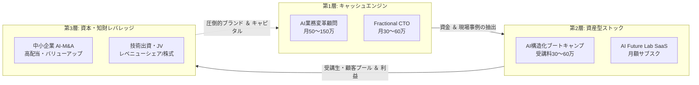

# 🚀 SHINTARO IMAMURA 収益化アイデア ビジュアルカタログ ＆ 収益ダッシュボード

> **「人と組織の可能性を、技術と仕組みで解放し、圧倒的な経済的豊かさを創る」**  
> 本ドキュメントは、今村真太郎氏の強み（構造化・要件定義 × AI実装 × 人間・組織変革）を元に、直感的に全体像と数字・仕組みを把握できるよう設計された**ビジュアルカード型カタログ＆収益ダッシュボード**です。

---

## 📊 1. EXECUTIVE REVENUE DASHBOARD（収益ダッシュボード）

### 🎯 3カ年 収益・労働構造シミュレーション

```
┌─────────────────────────┬─────────────────────────┬─────────────────────────┐
│  Phase 1: 即効キャッシュ │  Phase 2: ストック資産化 │  Phase 3: 資本レバレッジ │
│      （0〜6ヶ月）        │      （6〜18ヶ月）       │       （18ヶ月〜）       │
├─────────────────────────┼─────────────────────────┼─────────────────────────┤
│ 💰 想定年商: 3,000万円   │ 💰 想定年商: 8,000万円   │ 💰 想定年商: 1.5億〜3億円│
│ ⏱ 稼働時間: 120h/月     │ ⏱ 稼働時間: 60h/月      │ ⏱ 稼働時間: 20h/月 (自由)│
│ 📈 粗利率:   85%        │ 📈 粗利率:   90%        │ 📈 粗利率:   95%+配当    │
│ 🧱 ストック比率: 20%     │ 🧱 ストック比率: 60%     │ 🧱 ストック比率: 85%+株式│
│ 🎯 主軸: 高単価伴走・顧問 │ 🎯 主軸: スクール・SaaS  │ 🎯 主軸: JV・M&A・知財   │
└─────────────────────────┴─────────────────────────┴─────────────────────────┘
```

### 🌊 キャッシュフロー全体循環モデル



---

## 🗂 2. BUSINESS MODEL MATRIX（全18アイデア比較ダッシュボード）

各ビジネスモデルの**「単価・粗利・労働負荷・スケール性」**の一覧マトリクスです。

| # | アイデア名称 | 想定単価 | 粗利率 | 労働依存 | スケール | 即効性 | 最適フェーズ |
|:--:|:---|:---:|:---:|:---:|:---:|:---:|:---:|
| **01** | 中小企業向け「AI組織再設計」顧問 | 50〜150万/月 | 95% | 中 | ★★☆☆☆ | ⚡ 最速 | Phase 1 |
| **02** | Fractional CTO（AI戦略参謀） | 30〜60万/月 | 95% | 中 | ★★☆☆☆ | ⚡ 最速 | Phase 1 |
| **03** | 成果報酬型 AIコスト削減プロジェクト | 成功報酬20〜30% | 90% | 高 | ★★★☆☆ | 早 | Phase 1 |
| **04** | 新規事業 PoC高速実装PMO | 300〜600万/件 | 85% | 高 | ★★☆☆☆ | 早 | Phase 1 |
| **05** | AI要件定義＆設計エージェントSaaS | 3〜10万/月 | 90% | 低 | ★★★★★ | 中 | Phase 2 |
| **06** | 「AI Future Lab」知的SaaS基盤 | 3〜10万/月 | 95% | 極低 | ★★★★★ | 中 | Phase 2 |
| **07** | AI業務Blueprint（設計図）販売 | 5〜30万/本 | 99% | 極低 | ★★★★☆ | 早 | Phase 2 |
| **08** | 社内自律型RAG・ナレッジ導入キット | 100〜200万/件 | 80% | 低 | ★★★★☆ | 早 | Phase 2 |
| **09** | AI×構造化思考 実践ブートキャンプ | 30〜60万/人 | 85% | 中 | ★★★★☆ | 早 | Phase 2 |
| **10** | AIネイティブ経営マスターマインド | 120〜240万/年 | 90% | 低 | ★★★☆☆ | 中 | Phase 2 |
| **11** | ポテンシャル解放AIパーソナル伴走 | 10〜20万/月 | 85% | 中 | ★★★☆☆ | 早 | Phase 2 |
| **12** | 社内AIファシリテーター認定講座 | 150〜300万/社 | 90% | 低 | ★★★★☆ | 中 | Phase 2 |
| **13** | 技術・AI実装力出資（Sweat Equity） | 株式5〜15% | - | 極低 | ★★★★★ | 晩 | Phase 3 |
| **14** | 中小企業「AI-M&A」事業買収再生 | 数千万〜数億円 | 70%+ | 低 | ★★★★★ | 晩 | Phase 3 |
| **15** | 専門家・インフルエンサーとのJV | 利益50%折半 | 90% | 極低 | ★★★★★ | 早 | Phase 3 |
| **16** | 要件定義フレームワーク法人ライセンス | 100〜300万/年 | 99% | 極低 | ★★★★★ | 中 | Phase 3 |
| **17** | 商業出版＆ブランド確立 | 印税＋大型案件 | 95% | 極低 | ★★★★★ | 中 | Phase 3 |
| **18** | AI適応力＆組織診断Webツール | 数千〜数万/社 | 95% | 極低 | ★★★★★ | 中 | Phase 3 |

---

## 🃏 3. VISUAL CARDS CATALOG（ビジュアルカード型カタログ）

---

### 🏛 A. 高単価キャッシュエンジン（BtoB伴走・顧問）

```
┌────────────────────────────────────────────────────────────────────────┐
│ 💳 CARD 01 │ 中小企業向け「AIネイティブ組織・業務再設計」顧問                 │
├────────────┴───────────────────────────┬──────────────────────────────┤
│ 💰 想定単価: 月額 50万〜150万円 (最低3ヶ月〜) │ 📈 粗利率: 95%               │
│ ⏱ 所要時間: 週3〜5時間 / 社           │ 🚀 スケール性: ★★☆☆☆         │
├───────────────────────────────────────┴──────────────────────────────┤
│ 【顧客の課題】AIツールを入れたが現場が使いこなせず、業務が変わらない。        │
│ 【提供価値】　業務フローを棚卸し・構造化し、AIエージェントを実務に組み込む。 │
│ 【強み発揮】　「人間・現場の抵抗を解く対話」×「システム設計・業務要件定義」 │
│ 【収益試算】　3社契約 ＝ 月商 250万円（年商 3,000万円）                      │
└────────────────────────────────────────────────────────────────────────┘
```

```
┌────────────────────────────────────────────────────────────────────────┐
│ 💳 CARD 02 │ 非エンジニア経営者のための「Fractional CTO / AI戦略参謀」        │
├────────────┴───────────────────────────┬──────────────────────────────┤
│ 💰 想定単価: 月額 30万〜60万円 / 社    │ 📈 粗利率: 95%               │
│ ⏱ 所要時間: 月2回ミーティング＋チャット │ 🚀 スケール性: ★★☆☆☆         │
├───────────────────────────────────────┴──────────────────────────────┤
│ 【顧客の課題】社内にIT責任者がおらず、AI導入や外注管理で騙されないか不安。   │
│ 【提供価値】　経営者の曖昧な構想を要件定義化し、外部開発ベンダーを統括管理。 │
│ 【強み発揮】　経営者目線の事業構想力 × 技術的なシステム仕様策定力           │
│ 【収益試算】　4社並行 ＝ 月商 180万円（稼働時間は月20時間未満）              │
└────────────────────────────────────────────────────────────────────────┘
```

```
┌────────────────────────────────────────────────────────────────────────┐
│ 💳 CARD 03 │ 成果報酬連動型「AI業務自動化・コスト削減」プロジェクト            │
├────────────┴───────────────────────────┬──────────────────────────────┤
│ 💰 想定単価: 初期着手金100万 ＋ 削減費用の20〜30%（1〜2年間）                 │
│ ⏱ 所要時間: 集中2ヶ月導入 ＋ 保守     │ 📈 粗利率: 90%               │
├───────────────────────────────────────┴──────────────────────────────┤
│ 【提供価値】　バックオフィスの定型業務を徹底自動化し、人件費削減・余力を創出。│
│ 【強み発揮】　現場の業務手順を漏れなく論理構造化するPM・設計力              │
│ 【収益試算】　年間1,000万の工数削減達成時 ＝ 毎年200〜300万のインセンティブ │
└────────────────────────────────────────────────────────────────────────┘
```

```
┌────────────────────────────────────────────────────────────────────────┐
│ 💳 CARD 04 │ 新規事業 PoC・プロトタイプ高速実装PMO                            │
├────────────┴───────────────────────────┬──────────────────────────────┤
│ 💰 想定単価: 1プロジェクト 300万〜600万円│ 📈 粗利率: 85%               │
│ ⏱ 所要時間: 1〜2ヶ月集中プロジェクト   │ 🚀 スケール性: ★★☆☆☆         │
├───────────────────────────────────────┴──────────────────────────────┤
│ 【顧客の課題】新規事業のアイデアはあるが、動くプロトタイプが作れず検証が進まない│
│ 【提供価値】　AIエージェントを活用し、最短3週間で動くPoCシステムを具現化。     │
│ 【強み発揮】　「曖昧な構想を実行可能な構造に変える」真太郎氏の中核能力      │
└────────────────────────────────────────────────────────────────────────┘
```

---

### 📦 B. ストック型プロダクト＆SaaS（資産型）

```
┌────────────────────────────────────────────────────────────────────────┐
│ 💳 CARD 05 │ 業界特化型「AI要件定義＆システム設計エージェント」SaaS            │
├────────────┴───────────────────────────┬──────────────────────────────┤
│ 💰 想定単価: 月額 5万〜15万円 / 社     │ 📈 粗利率: 90%               │
│ ⏱ 所要時間: システム保守・機能改善のみ │ 🚀 スケール性: ★★★★★         │
├───────────────────────────────────────┴──────────────────────────────┤
│ 【仕組み】　クライアントが対話するだけで、仕様書・業務フロー図・DB定義を自動生成│
│ 【対象顧客】受託開発会社、Web制作会社、中小SIer、自社情シス部門              │
│ 【強み発揮】長年の要件定義ノウハウとAIプロンプトエンジニアリングの融合       │
│ 【収益試算】100社導入 ＝ 月商 800万円（年商 約1億円の完全ストック）           │
└────────────────────────────────────────────────────────────────────────┘
```

```
┌────────────────────────────────────────────────────────────────────────┐
│ 💳 CARD 06 │ 「AI Future Lab」知的探究・意思決定支援プラットフォーム          │
├────────────┴───────────────────────────┬──────────────────────────────┤
│ 💰 想定単価: 月額 3万〜10万円 / 会員   │ 📈 粗利率: 95%               │
│ ⏱ 所要時間: 週2時間（最新知見の監修）  │ 🚀 スケール性: ★★★★★         │
├───────────────────────────────────────┴──────────────────────────────┤
│ 【仕組み】　最新AI動向・多分野の知見をAIが巡回・構造化し、経営者に問いを届ける│
│ 【対象顧客】先進的な経営者、イノベーター、思考を深めたい知的人材             │
│ 【強み発揮】哲学・ロボティクス・人間理解を横断する「AI Future Lab」構想の具現化│
│ 【収益試算】50名参加 ＝ 月商 250万円（年商 3,000万円）                      │
└────────────────────────────────────────────────────────────────────────┘
```

```
┌────────────────────────────────────────────────────────────────────────┐
│ 💳 CARD 07 │ 実務実証済み「AI業務フロー＆プロンプトBlueprint」販売           │
├────────────┴───────────────────────────┬──────────────────────────────┤
│ 💰 想定単価: 1テンプレート 5万〜20万円 │ 📈 粗利率: 99%               │
│ ⏱ 所要時間: 初回作成のみ（ほぼゼロ）   │ 🚀 スケール性: ★★★★☆         │
├───────────────────────────────────────┴──────────────────────────────┤
│ 【仕組み】　Dify / Make / Claude 等で組んだ実務直結ワークフローの設計図販売   │
│ 【収益試算】月間30本販売 ＝ 月商 300万円（完全自動不労収益）                 │
└────────────────────────────────────────────────────────────────────────┘
```

```
┌────────────────────────────────────────────────────────────────────────┐
│ 💳 CARD 08 │ 社内自律型RAG・ナレッジエージェント導入キット                    │
├────────────┴───────────────────────────┬──────────────────────────────┤
│ 💰 想定単価: 初期 150万円 ＋ 月額保守 10万円│ 📈 粗利率: 85%            │
│ 【仕組み】　社内規定や過去の議事録を読み込ませ、社内FAQ・教育を自律化する仕組み│
│ 【収益試算】年間15社導入 ＝ 初期 2,250万 ＋ 年間保守 1,800万 ＝ 4,050万円     │
└────────────────────────────────────────────────────────────────────────┘
```

---

### 🧠 C. 人間変革・教育・コミュニティ（高粗利 知的資本）

```
┌────────────────────────────────────────────────────────────────────────┐
│ 💳 CARD 09 │ AI×構造化思考 実践ブートキャンプ（選抜制）                       │
├────────────┴───────────────────────────┬──────────────────────────────┤
│ 💰 想定単価: 受講料 40万〜60万円 / 人  │ 📈 粗利率: 85%               │
│ ⏱ 所要時間: 3ヶ月（週1回講義＋AI添削） │ 🚀 スケール性: ★★★★☆         │
├───────────────────────────────────────┴──────────────────────────────┤
│ 【提供価値】プログラミングではなく「課題を構造化しAIで動く仕組みに変える」思考法│
│ 【対象顧客】DX担当者、事業企画職、コンサルタント、フリーランスエンジニア     │
│ 【強み発揮】「教育・変化への関心」×「構造化・システム設計メソッド」        │
│ 【収益試算】1期20名 × 年3回 ＝ 年商 3,000万〜3,600万円                       │
└────────────────────────────────────────────────────────────────────────┘
```

```
┌────────────────────────────────────────────────────────────────────────┐
│ 💳 CARD 10 │ 「AIネイティブ経営マスターマインド」（招待制エグゼクティブ）      │
├────────────┴───────────────────────────┬──────────────────────────────┤
│ 💰 想定単価: 年会費 150万〜240万円     │ 📈 粗利率: 90%               │
│ ⏱ 所要時間: 隔月定例会 ＋ 年1回合宿   │ 🚀 スケール性: ★★★☆☆         │
├───────────────────────────────────────┴──────────────────────────────┤
│ 【提供価値】AI時代における組織・ビジネス・自己の再設計を語り合う経営者共同体  │
│ 【収益試算】限定15名 ＝ 年商 3,000万円（極めて強固な人脈と高収益基盤）       │
└────────────────────────────────────────────────────────────────────────┘
```

```
┌────────────────────────────────────────────────────────────────────────┐
│ 💳 CARD 11 │ ポテンシャル解放「AIパーソナル伴走エージェント」                 │
├────────────┴───────────────────────────┬──────────────────────────────┤
│ 💰 想定単価: 月額 10万〜20万円 / 人    │ 📈 粗利率: 85%               │
│ 【提供価値】個人の価値観や思考の癖をAIが分析・壁打ちし、真太郎氏が月1回伴走  │
│ 【強み発揮】自己理解・内面の変化・意味の創造という哲学的探究のマネタイズ      │
│ 【収益試算】クライアント15名 ＝ 月商 200万円（年商 2,400万円）               │
└────────────────────────────────────────────────────────────────────────┘
```

```
┌────────────────────────────────────────────────────────────────────────┐
│ 💳 CARD 12 │ 企業の「社内AIファシリテーター」育成・認定プログラム             │
├────────────┴───────────────────────────┬──────────────────────────────┤
│ 💰 想定単価: 1社一括 200万〜300万円    │ 📈 粗利率: 90%               │
│ 【提供価値】外部に頼らず自社内でAI改善を回せる「チェンジリーダー」を社内に育成│
│ 【収益試算】年10社契約 ＝ 年商 2,500万円                                      │
└────────────────────────────────────────────────────────────────────────┘
```

---

### 💎 D. 資本レバレッジ・JV・M&A（指数関数的アップサイド）

```
┌────────────────────────────────────────────────────────────────────────┐
│ 💳 CARD 13 │ 「技術・AI実装力出資（Sweat Equity）」による株式獲得             │
├────────────┴───────────────────────────┬──────────────────────────────┤
│ 💰 リターン: 対象企業の株式 5〜15% ＋ 将来のエグジット利益（数千万〜数億円）   │
│ ⏱ 所要時間: 月数時間のアーキテクチャ監修│ 🚀 スケール性: ★★★★★         │
├───────────────────────────────────────┴──────────────────────────────┤
│ 【仕組み】　資金の代わりに「AI組織基盤の構築」「CTO機能」を提供し株主になる。 │
│ 【強み発揮】投資家にはできない「現場で動くAIシステムの実装・PM」を提供可能   │
└────────────────────────────────────────────────────────────────────────┘
```

```
┌────────────────────────────────────────────────────────────────────────┐
│ 💳 CARD 14 │ 中小企業「AI-M&A（AIロールアップ）」事業買収・高収益化           │
├────────────┴───────────────────────────┬──────────────────────────────┤
│ 💰 リターン: 年間数千万円の配当 ＋ 数年後の売却益（1社あたり数億円）          │
│ 【仕組み】　営業利益2,000〜5,000万の後継者不足の中小企業を共同買収。         │
│ 　　　　　　業務フローをAIで全自動化し、利益率を倍増させて配当または売却。   │
│ 【強み発揮】泥臭い業務整理 × システム化による利益率改善の確実な遂行         │
└────────────────────────────────────────────────────────────────────────┘
```

```
┌────────────────────────────────────────────────────────────────────────┐
│ 💳 CARD 15 │ 専門家・インフルエンサーとのジョイントベンチャー（JV）           │
├────────────┴───────────────────────────┬──────────────────────────────┤
│ 💰 リターン: 売上・利益の50%レベニューシェア（月数百万円〜）                  │
│ 【仕組み】　集客力はあるがITが苦手な医師・士業・専門家と組み、AIツールを共同開発│
│ 【メリット】集客コストゼロで、初月から圧倒的な売上・利益を配分                │
└────────────────────────────────────────────────────────────────────────┘
```

---

### 🛡 E. 知財ライセンス・ブランド資産（スケールビジネス）

```
┌────────────────────────────────────────────────────────────────────────┐
│ 💳 CARD 16 │ 業務構造化＆AI要件定義フレームワークの法人ライセンス              │
├────────────┴───────────────────────────┬──────────────────────────────┤
│ 💰 想定単価: 年間 120万〜300万円 / 社  │ 📈 粗利率: 99% (知財ビジネス)│
│ 【仕組み】　大手SIer・コンサル向けに、要件定義メソッドを社内標準として貸与    │
│ 【収益試算】20社導入 ＝ 年間 3,600万円の完全ロイヤリティ収入                 │
└────────────────────────────────────────────────────────────────────────┘
```

```
┌────────────────────────────────────────────────────────────────────────┐
│ 💳 CARD 17 │ 商業出版 ＆ メディアブランディング                              │
├────────────┴───────────────────────────┬──────────────────────────────┤
│ 📚 タイトル案:『AIネイティブの思考法：人と組織の可能性を解放する技術』         │
│ 【リターン】印税 ＋ 1回100万円の役員講演 ＋ 完全インバウンドでの顧問受注       │
└────────────────────────────────────────────────────────────────────────┘
```

```
┌────────────────────────────────────────────────────────────────────────┐
│ 💳 CARD 18 │ 「AI適応力＆組織ポテンシャル診断」アセスメントWebシステム         │
├────────────┴───────────────────────────┬──────────────────────────────┤
│ 💰 想定単価: 受検料 1人 3,000〜5,000円 │ 📈 粗利率: 95%               │
│ 【仕組み】　Web上で社員が受検し組織のAI適応阻害要因をレポート出力。コンサルへ誘導│
└────────────────────────────────────────────────────────────────────────┘
```

---

## 🏁 4. NEXT 90 DAYS: 最速収益化アクションプラン

```
┌───────────────────────────────────────────────────────────────────────┐
│ 🚀 最初の90日で月商200万円・年商3,000万円ペースに乗せる3ステップ      │
├───────────────────────────────────────────────────────────────────────┤
│                                                                       │
│  【Day 1〜30: パッケージング】                                        │
│   1. [CARD 01]「AIネイティブ業務再設計（顧問）」の提案書スライド（10枚）作成 │
│   2. 過去のシステム開発実績を「AI×業務改革」文脈に再定義した事例シート作成│
│   3. 既存の知人経営者・取引先5社に「無料AI業務フロー診断」を実施      │
│                                                                       │
│  【Day 31〜60: 初動キャッシュ獲得】                                  │
│   1. 診断した企業のうち2社を月額50万〜80万の顧問（3ヶ月契約）に転換   │
│   2. 実務で使ったプロンプトとフローを[CARD 07]Blueprintとして蓄積     │
│   3. [CARD 02]Fractional CTOとして1社（月40万）受注                   │
│      👉 ★この時点で月商150万〜200万（年換算2,000万超）達成            │
│                                                                       │
│  【Day 61〜90: 資産化・コミュニティ準備】                             │
│   1. 現場で得た生々しい変革データを元に[CARD 09]ブートキャンプの構想発表│
│   2. 0期生（パイロット受講生）を5〜10名限定募集（1人30万円）         │
│   3. 次期SaaS（[CARD 05]）に向けた要件定義をAIエージェントで自己実装 │
│                                                                       │
└───────────────────────────────────────────────────────────────────────┘
```
