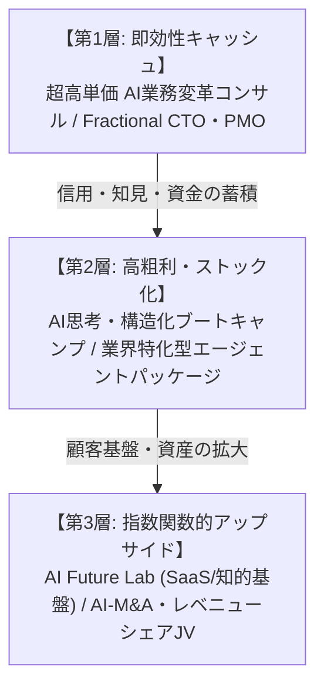

# 今村真太郎氏の強みを最大化して経済的豊かさを実現する事業・収益化アイデア集

**作成日:** 2026年10月31日  
**対象者:** 今村真太郎（システム設計者／プロジェクトマネージャー／AIネイティブ構想家）  
**目的:** 固有の強み・専門性・人間理解への探究心を掛け合わせ、単なる労働集約から脱却し、経済的な豊かさ（高収益・ストック型資産・資本的レバレッジ）を最大化するための具体的事業アイデアの体系化。

---

## 1. 収益化におけるコア強みの整理とレバレッジ構造

今村真太郎氏が持つ最大の価値は、**「①抽象的な課題や人間の内面を構造化する力」「②技術（システム/AI）とビジネス現場を繋ぐ実装力」「③AIを人間の能力拡張として捉える先進的視点」**が三位一体となっている点にあります。

多くのエンジニアは「技術」に閉じ、多くのコンサルやコーチは「実装」ができません。また、一般的なAI活用者は「ツールの操作（プロンプト）」にとどまり、組織構造や業務フロー全体の再設計まで踏み込めません。

この**「構造化 × 実装力 × 人間・組織への深い理解」**という希少なポジショニングをテコにすることで、以下の3層構造で経済的豊かさを構築できます。

---

## 2. カテゴリ別 収益化・事業アイデア（全18選）

### A. 【高単価・短期的キャッシュエンジン】BtoB AI変革・伴走コンサルティング
受託開発の「人月商売」から脱却し、**「経営課題の解決」「余力・利益の創出」に対してプライシング**するモデルです。

#### 1. 中小・中堅企業向け「AIネイティブ組織・業務再設計」顧問サービス
- **概要:** 「AIツールを導入したが使われない」企業に対し、業務フローの構造化・棚卸しからAIエージェントの業務組み込み、社員の意識変容・研修までを一気通貫で伴走。
- **提供価値:** 残業削減、業務スピード3〜5倍化、属人化の解消。
- **収益モデル:** 月額顧問料 50万円〜150万円（3〜6ヶ月契約）。

#### 2. 非エンジニア経営者のための「Fractional CTO / AI戦略参謀」
- **概要:** 自社にIT・AIの専門家がいない中小企業の経営者専属で、技術選定、AI投資判断、外注ベンダーのディレクション・要件定義を代行。
- **強みの活用:** 経営者の曖昧なビジョンを即座に要件定義・仕様書へ落とし込む力。
- **収益モデル:** 1社あたり月額30万〜60万円（工数は月数日相当）。複数社並行で月商200万〜300万円を安定化。

#### 3. 成果報酬連動型「AI業務自動化・コスト削減」プロジェクト
- **概要:** バックオフィス（経理・労務・受発注・カスタマーサポート）の定型業務をAIとシステム連携で極限まで自動化。
- **収益モデル:** 基本設計費（ミニマム）＋ **削減できた人件費・工数の20〜30%を1〜2年間レベニューシェア**として受領。上限のないアップサイドを獲得可能。

#### 4. 大企業・メガベンチャー向け「AI新規事業 PoC・プロトタイプ高速実装PMO」
- **概要:** 企画フェーズでスタックしている新規事業部署に対し、要件定義からAIエージェントを組み込んだPoC（概念実証）アプリの構築・検証までを最短1ヶ月でリード。
- **収益モデル:** 1プロジェクト 300万〜600万円。

---

### B. 【ストック型・プロダクト＆仕組み化】AIエージェント・知財の資産化
自身の時間を切り売りせず、一度作った仕組みが継続的に収益を生むモデルです。

#### 5. 業界特化型「AI要件定義＆設計エージェント」SaaS
- **概要:** 過去のシステム開発・要件定義のノウハウを凝縮し、クライアントが対話するだけで「要求仕様書」「業務フロー図」「DB基本設計」を自動生成するエージェントツール。
- **対象:** 受託開発会社、Web制作会社、社内SE部門。
- **収益モデル:** 月額サブスクリプション（月額3万〜10万円/企業）。

#### 6. 「AI Future Lab」知的探究・意思決定支援プラットフォーム
- **概要:** 経営者や事業リーダー向けに、最新の技術動向・競合調査・市場データをAIが自動巡回・構造化し、自社の意思決定に合わせたサマリーや問いを提供するインテリジェンス基盤。
- **強みの活用:** 探究心、多分野の接点発見、ナレッジの体系化。
- **収益モデル:** 月額会員制（月額3万円〜10万円）＋ プレミアム個別壁打ち枠。

#### 7. 実証済み「AI業務プロンプト＆ワークフロー」ライブラリのライセンス販売
- **概要:** 実際の業務現場で磨き上げたDify、Make、n8n、Claude、OpenAI等による実践ワークフローの設計図（Blueprint）をパッケージ化して販売。
- **収益モデル:** 買い切り販売（数万〜数十万円）＋ アップデート購読権。

#### 8. 社内自律型RAG・ナレッジエージェント導入テンプレート
- **概要:** 社内規程、マニュアル、過去の議事録・日報をAIが学習し、新入社員の教育や業務判断の壁打ちを自動化するテンプレート型システム。
- **収益モデル:** 初期導入パッケージ費用（100万〜200万円）＋ 月額保守（5万〜15万円）。

---

### C. 【教育・人間変革・コミュニティ】高粗利・高LTVの知的資本ビジネス
人間の可能性や内面的な変化への関心と、システム思考を掛け合わせた独自性の極めて高い領域です。

#### 9. 次世代リーダー向け「AI×構造化思考×システムアーキテクチャ」実践スクール
- **概要:** プログラミングを教えるのではなく、「曖昧な世界を構造化し、AIを使って自力で動く仕組みに変える力」を鍛える選抜制ブートキャンプ。
- **対象:** 企画職、PM、ビジネスパーソン、起業家。
- **収益モデル:** 3ヶ月プログラム（受講料 30万〜60万円/人、定員制で高密度提供）。

#### 10. AIネイティブ経営マスターマインド（招待制エグゼクティブコミュニティ）
- **概要:** 「AI時代に組織と自分自身をどう再設計するか」を真剣に考える経営者・役員限定のコミュニティ。定期リトリート、先端事例研究、メンバー同士のコラボレーション。
- **収益モデル:** 年会費 120万〜240万円（会員20〜30名で年商数千万円規模・高粗利）。

#### 11. 「AI×内面変革」ポテンシャル解放パーソナルエージェントプログラム
- **概要:** 個人の価値観、思考の偏り、目標をAIエージェントにログ化・対話させ、日々の行動変容を促す仕組み＋今村氏による月1回の深層コーチング。
- **強みの活用:** 「人はどう変わるのか」「自己理解と行動」への深い探究。
- **収益モデル:** 月額10万〜20万円のパーソナル伴走サービス。

#### 12. 企業の「社内AIファシリテーター（変革リーダー）」育成・認定講座
- **概要:** 企業内にAI文化を定着させるリーダー（社員）を育てるための法人向け研修パッケージ。修了者には認定証を付与し、社内改善を推進させる。
- **収益モデル:** 1社あたり150万〜300万円（一括研修契約）。

---

### D. 【資本参加・レベニューシェア・JV】指数関数的アップサイドを狙う展開
自身の知見を「資本」として投じ、ビジネスの成長果実を得るモデルです。

#### 13. 「AI・技術力出資（Sweat Equity）」によるスタートアップ・中小企業参画
- **概要:** 現金投資の代わりに「AI業務基盤の構築」「PM・システム設計」を提供し、対象企業の株式（5〜15%）または将来の利益分配権を獲得。
- **効果:** 成功時のキャピタルゲイン（数千万円〜数億円単位）を狙えるポートフォリオを構築。

#### 14. 伝統的・後継者不在の中小企業に対する「AI-M&A（AIロールアップ）」
- **概要:** 利益は出ているがIT化・AI化が著しく遅れている中小企業（製造、卸売、士業、不動産等）を共同出資等で買収し、徹底的にAIとシステムで業務自動化・利益率向上を行ってバイアウトまたは高配当化。
- **強みの活用:** 業務フロー整理、泥臭い関係者調整、システム化の実行力。

#### 15. 特定領域のインフルエンサー・専門家とのジョイントベンチャー（JV）
- **概要:** 専門知識や集客力はあるが仕組み化・IT化ができない専門家（医師、弁護士、人気講師、クリエイター等）とタッグを組み、彼らの頭脳をAIサービスやスクールにして折半。
- **メリット:** 集客コストゼロで、初月から大きな売上と利益配分を実現。

---

### E. 【独自メソッド・知財ライセンス】スケールする知的財産ビジネス

#### 16. 「業務構造化＆AI要件定義フレームワーク」の法人ライセンス
- **概要:** 曖昧な要件を破綻なくAIに実装させる独自フレームワークを商標・メソッド化し、SIerやコンサルティング会社向けにライセンス提供。
- **収益モデル:** 年間ライセンスフィー 100万〜300万円/社。

#### 17. 商業出版・オウンドメディアからの「第一想起」ブランディング
- **テーマ案:** 『AIネイティブ思考法：技術を使って人間の可能性を解放する技術』『要件定義がすべて：AI時代に生き残る構造化の極意』
- **効果:** 書籍自体による印税に加え、高単価な講演（1本50万〜100万円）、役員研修、大型コンサル案件の完全インバウンド化。

#### 18. 「AI適応力＆組織ポテンシャル診断」アセスメントWebツールの開発
- **概要:** 社員や組織が「どれだけAIネイティブに移行できる状態にあるか」「個人のどのポテンシャルがブロックされているか」を測るWeb診断ツール。
- **収益モデル:** 診断受検料（1人あたり数千円）＋ 診断結果に基づく改善コンサルティングへの送客。

---

## 3. 経済的豊かさを実現する「3ステップ収益拡大ロードマップ」

短期的な資金力と長期的な資産・自由を両立するためのステップ設計です。

| フェーズ | 重点テーマ | 主な事業アイデア | 目標年商・収益イメージ | 狙い |
| :--- | :--- | :--- | :--- | :--- |
| **Phase 1: 即効キャッシュと実績蓄積** (0〜6ヶ月) | 高単価BtoB伴走 | ・AI業務変革コンサル（アイデア1） ・Fractional CTO（アイデア2） | 年商 2,500万〜4,000万円 | 確実なキャッシュフローと、実証事例（Before/Afterの数値）を作る |
| **Phase 2: 仕組み化・ストック資産の構築** (6〜18ヶ月) | 教育・SaaS・コミュニティ | ・構造化思考スクール（アイデア9） ・AI Future Lab会員制（アイデア6） ・エージェントSaaS（アイデア5） | 年商 5,000万〜1億円 （利益率70%以上） | 労働集約から抜け出し、時間的自由とストック収益を確立する |
| **Phase 3: 資本レバレッジとエコシステム** (18ヶ月以降) | 出資・JV・知財ビジネス | ・技術出資（アイデア13） ・AI-M&A（アイデア14） ・出版＆知財ライセンス（アイデア16, 17） | 年商 数億円規模 ＋ キャピタルゲイン資産 | 資本主義的なアップサイドを取り、真の経済的・時間的自由を達成 |

---

## 4. 経済的豊かさを加速させる「成功の鍵（キーサクセスファクター）」

1. **「工数売り」を完全にやめる（Value-based Pricing）:**  
   「月◯時間稼働するからいくら」という契約ではなく、「この業務フローをAIで刷新し、年間1,000万円の余力を生むから初期300万円＋月額50万円」というように、**創出価値ベース**で価格設定を行う。

2. **「Before / After」の構造化ログを残す:**  
   関わった案件の「導入前フロー」「AI導入後フロー」「削減時間」「生まれた新規価値」を徹底的にドキュメント化し、そのまま次の営業資料・教育コンテンツ・書籍の原稿に転用する。

3. **「システム屋」ではなく「可能性の解放者」としてブランディングする:**  
   単なる「AIに詳しいエンジニア」はコモディティ化（価格競争）します。しかし、「組織と人の可能性を構造化し、AIで解放するパートナー」というポジショニングは競合が存在せず、顧客は言い値で発注するようになります。
